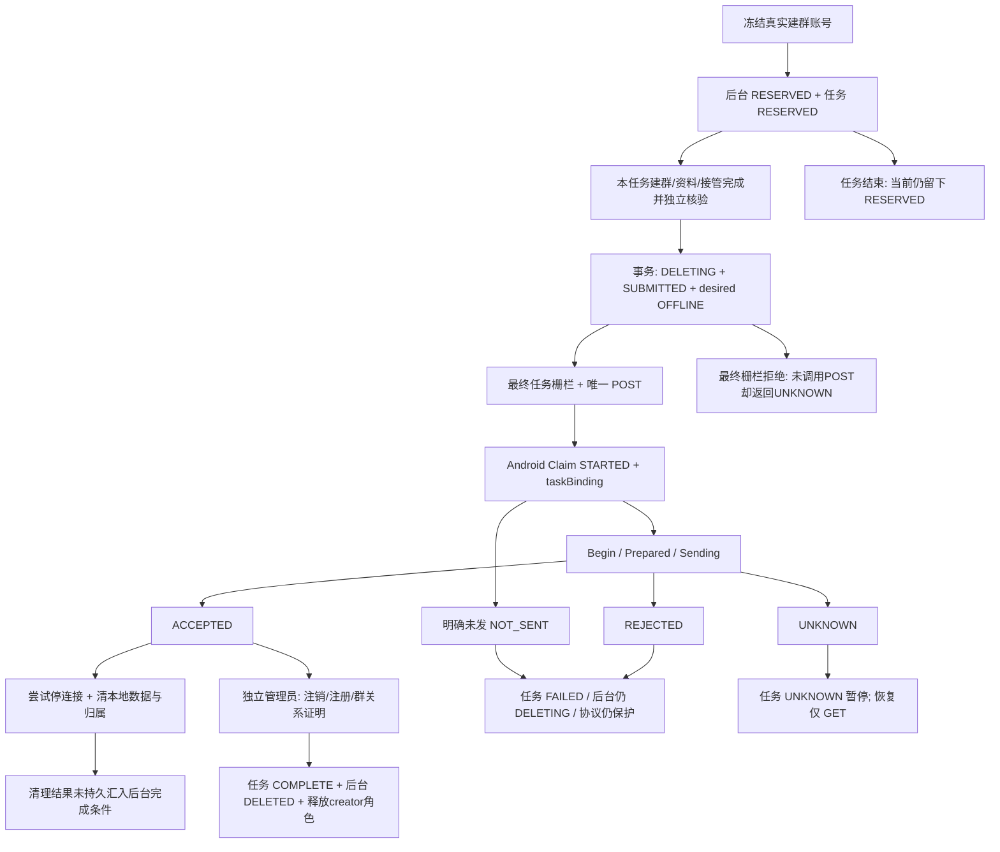

# Armada 建群账号注销保护：跨层影响与最小修复方案

审计日期：2026-10-07；现场仅 perf2。北京时间 07:23—07:30 的只读观察，数据库、Redis、协议缓存和运行制品不是同一原子快照。本轮未修改业务代码、未部署、未修改现场 MySQL/Redis，未执行真实注销、发送、拉人、账号上下线。只新增本报告、脱敏证据和隔离本地复现材料。

## 1. 先回答业务问题

除上下线外，这套保护还影响 **业务选号与资源补充、群资料/成员/邀请码查询和同步、联系人步骤、营销派发与重试、群事件/部分结果回写、迁移分组、凭据导出、平台删除、任务结束回收及同号重新导入**。问题不是“所有操作都被挡住”，而是三种口径不一致：

1. **挡得过宽**：把“不可派新业务”用于“账号是否存在”的公共查询，导致可信旧结果和群事件找不到账号；尚未发送的预留没有结束释放；任务绑定的明确未发/拒绝也没有恢复出口。
2. **挡得不全**：养号、普通营销、拉群营销的部分候选/占用查询漏掉保护，直接 HTTP 业务入口绕过 outbox。结果可能是选入后整轮失败，或其他业务仍占用本应独占的建群账号，反过来阻止注销。
3. **状态未收口**：注销完成不更新旧 NORMAL 事实的使用口径，页面仍算正常，导出可交付失效材料，群关系/代理/协议清理缺少统一终态处理；未知结果、迟到结果和结束任务之间也缺乏独立收敛。

**本轮现场确认的是两条已结束任务的 RESERVED 残留，其中一条仍限制未软删除账号 2757。** 更广泛的候选漏防、回调隐去、导出错误放行等由当前代码和隔离复现确认，不能写成它们都已在 perf2 发生事故。当前没有 taskBinding 的 NOT_SENT、REJECTED、UNKNOWN 样本，也没有后台 DELETING/DELETED 样本。

## 2. 证据层级和当前版本

证据代号：**L**=本轮现场只读事实；**T**=隔离真实实现复现；**S**=当前源码确定的控制流；**R**=满足特定并发/运行条件才触发、尚未现场验证。测试复现错误行为的 PASS 不表示功能正确。

| 仓库 | 当前分支 / HEAD | 未提交状态及本轮处理 |
|---|---|---|
| armada | 1.0.3-snapshot / c9a59b24 | 已有批量生命周期、上线命令、outbox补丁及测试/新增异常类；全部保留 |
| wheel-saas-pure-web | 1.0.3-snapshot / c3df6e2c | 已有3个批量操作相关文件修改；保留 |
| Android Zhuan | 1.0.3-snapshot / 8d05bb17 | 已有login/vo/executor准备错误分类和iq审批解析等修改；保留 |
| armada-protocol | 1.0.3-snapshot / 5f8a4e5 | 干净；未发现本仓AGENTS.md |

逐仓读取规则、检查 worktree/status；均分析现有主 checkout，未切换/清理任何 worktree。[完整基线](/Users/daishuaishuai/IdeaProjects/armada/docs/operations/evidence/creator-deletion-impact-perf2-20261007/baseline.json)。

| perf2运行层 | 本轮证据 | 可得结论 / 边界 |
|---|---|---|
| 后端 | JAR SHA256 `3c072c843299ff1ba13a539bc64db7c391a8f6c4e3ab78b78117a6dbd0670939`；启动 10-06 21:12:52 北京时间；3029个class/Mapper条目匹配本地target，Mapper另比源码 | 当前批量隔离补丁在运行产物中；不能把未提交补丁说成已提交HEAD。[明细](/Users/daishuaishuai/IdeaProjects/armada/docs/operations/evidence/creator-deletion-impact-perf2-20261007/backend-runtime.json) |
| 前端 | 首页、入口、账号chunk哈希与既有修复产物相同；实际chunk含accepted===0/部分受理/未受理/batchErrors | 批量提示修复仍在运行，不代表列表生命周期显示已修。[明细](/Users/daishuaishuai/IdeaProjects/armada/docs/operations/evidence/creator-deletion-impact-perf2-20261007/frontend-runtime.json) |
| Android | `/proc/1/exe`与`/app/whatsapp-server`同为`8428ec27febd6053f0e9f357422fdd87b8e3d09d8735c4cf9f312e8f44170183`；启动10-06 23:01:55；远端662个api/internal Go文件匹配工作区 | 已不是旧报告里的二进制；磁盘源码匹配与运行二进制哈希分别记录，不以源码哈希单独证明每一行的编译来源。[明细](/Users/daishuaishuai/IdeaProjects/armada/docs/operations/evidence/creator-deletion-impact-perf2-20261007/android-runtime.json) |
| Web | 5个master/worker均online；运行路径指向所查dist；261个src、417个dist文件匹配本地 | 源码和部署文件一致；未导出进程内JS堆。[明细](/Users/daishuaishuai/IdeaProjects/armada/docs/operations/evidence/creator-deletion-impact-perf2-20261007/web-runtime.json) |

原报告的“页面批量受限账号拖垮全批”“前端一律成功”“登录准备1001直接归PROXY_FAILED”对应修复已在当前代码/运行制品中。以下报告不把它们重复登记为所有入口仍存在的故障；兼容接口、其他批量业务与后续异步竞态另论。

## 3. 状态模型：不能合并成一个注销状态

| 状态域 | 创建者 / 生效点 | 推进者 / 释放条件 | 与其他状态的关系 |
|---|---|---|---|
| account_creator_deletion | NEW_GROUP冻结真实creator时reserve，检查主设备、身份别名、已有业务依赖；写RESERVED | claimSubmission前begin→DELETING；匹配ACCEPTED且独立证明完整才complete→DELETED；**无预留释放入口** | RESERVED已影响候选/outbox，但尚不表示向WhatsApp发送；DELETED也不等于平台软删 |
| pull_task_creator_deletion | 冻结执行时写RESERVED(0)，保留task/execution/creator/createOperation/预定operation | SUBMITTED(1)唯一发送意图；ACCEPTED(2)已接收待核验；UNKNOWN(3)只读对账；FAILED(4)暂停；COMPLETE(5)放行后续联系人/拉人 | 账号生命周期在SUBMITTED/ACCEPTED/UNKNOWN/FAILED阶段通常仍DELETING；attempts是记录/核验次数，不是注销重发次数 |
| Android持久记录 | ClaimTask SET NX写STARTED，按号码hash唯一，无TTL | 持久保存NOT_SENT/REJECTED/UNKNOWN/ACCEPTED等；GET只读重放；taskBinding不可删改 | 有taskBinding时**所有状态都Blocked**；非任务NOT_SENT/REJECTED允许恢复，其余保守阻断 |
| Android进程状态 | Begin: Idle→Prepared，冻结sender但保留连接以发送删除IQ | Sending→Accepted/Rejected/NotSent/Unknown；ACCEPTED持久化后清理→Completed；任务拒绝不允许Release | 进程态随重启消失，Redis记录不消失；没有Java RESERVED对应的同步进程态 |
| account_state | 普通生命周期/风控业务状态，2=NORMAL等 | 当前注销complete只改登录/期望状态、invalidated_at，未改account_state | 不能单独据NORMAL判可调用；现有消费者仍这样使用，形成缺陷 |
| login_state / desired_login_state | 实际回写快照 / 平台期望 | begin只冻结desired=OFFLINE；complete设login=OFFLINE | 两者都不是实时网络证明；RESERVED没有自动冻结期望上线 |

两端不是原子事务：D后崩溃、E前结束、POST后结果返回前结束/租约丢失，都会形成不同缺口。**“未提交”要有持久发送边界证据；“已提交但未知”必须继续保护，不能超时解锁。**

平台软删除只使account.deleted_at生效；WhatsApp永久注销是不可逆外部动作；退出登录/StopNetwork只是停连接；设备解绑移除伴随设备；退群只改变群成员关系。五者不能互相冒充完成证明。

关键实现：[AccountCreatorDeletionServiceImpl:48](/Users/daishuaishuai/IdeaProjects/armada/armada-api/src/main/java/com/armada/account/service/impl/AccountCreatorDeletionServiceImpl.java:48)、[AccountCreatorDeletionMapper:102](/Users/daishuaishuai/IdeaProjects/armada/armada-api/src/main/resources/mapper/account/AccountCreatorDeletionMapper.xml:102)、[PullTaskCreatorDeletionTransactionService:130](/Users/daishuaishuai/IdeaProjects/armada/armada-api/src/main/java/com/armada/task/scheduler/PullTaskCreatorDeletionTransactionService.java:130)。精确可点击源码引用见后面的证据索引和分层细节。

## 4. 本轮现场：存量、时长、影响数量

以07:24:41数据库快照、07:26:58 Redis快照为主；时间均北京时间，证据原始时间为UTC。

| 项目 | 当前事实 |
|---|---|
| 后台账号账本 | RESERVED=2；DELETING=0；DELETED=0 |
| 任务注销账本 | RESERVED(0)=2；其他状态=0；两条attempts=0、submitted_at=NULL、账号账本operation_id=NULL |
| 终态关联 | 任务64/执行303、任务65/执行305均任务ENDED、执行6；不是仍执行注销中的任务 |
| 2755 | 已平台软删；RESERVED从10-06 19:35:19保留约11小时49分；结束后约9小时53分；角色已释放，无绑定代理 |
| 2757 | 未软删；RESERVED从10-06 22:44:39保留约8小时40分；结束后约8小时34分；NORMAL/ONLINE/desiredONLINE；creator角色未released，绑定代理1；无租约、无dispatched_at、无执行锁 |
| 别名命中 | 两个身份仅命中2个账号、1个租户；其中非软删1个。未发现当前跨租户/跨协议别名现场样本 |
| Redis注销记录 | 完整扫描perf专用前缀：ACCEPTED=2（1038/1736，无taskBinding、无TTL）；STARTED/PENDING/UNKNOWN/NOT_SENT/REJECTED=0；2755/2757精确key不存在 |
| 1038/1736 | 两账号均软删、UNBOUND/OFFLINE/desiredOFFLINE、无代理绑定；保留ACCEPTED tombstone合理，不能释放 |
| 协议缓存GET | 07:29:29以规范化wsPhone读取4样本，均Code1003“不存在或离线”。2757与DB ONLINE不一致，但这是缓存GET，不构成网络抓包或WhatsApp可用性证明 |
| 本轮直接受限数量 | 2个终态任务遗留预留；1个未删账号仍被后台限制。不是“2个正在运行任务被卡住” |
| 活动依赖 | 四样本的活动拉群角色、营销占用、进群、超链、feed、好友、拉群营销、历史群、剧本在途、互加联系人、普通建群creator/member检查均0；无这些样本待派/派发中outbox记录 |
| 分组702 | 总5、未删4、DB在线4、未命中预留3。没有“整个分组耗尽”的证据；该数只排注销，不等于其他资格全部满足 |
| 群关系 | canonical binding仍有1038=4、1736=4、2755=2、2757=9；binding行本身不证明当前仍在群，不能仅据行数宣布脏成员关系 |

[数据库快照](/Users/daishuaishuai/IdeaProjects/armada/docs/operations/evidence/creator-deletion-impact-perf2-20261007/snapshot.tsv)、[资源与持续时长](/Users/daishuaishuai/IdeaProjects/armada/docs/operations/evidence/creator-deletion-impact-perf2-20261007/resources.tsv)、[跨业务活动依赖](/Users/daishuaishuai/IdeaProjects/armada/docs/operations/evidence/creator-deletion-impact-perf2-20261007/dependencies.tsv)、[Redis快照](/Users/daishuaishuai/IdeaProjects/armada/docs/operations/evidence/creator-deletion-impact-perf2-20261007/redis-snapshot.json)、[缓存状态](/Users/daishuaishuai/IdeaProjects/armada/docs/operations/evidence/creator-deletion-impact-perf2-20261007/protocol-status.json)。原始SELECT保存在同目录，均由READ ONLY事务执行。未返回密码、凭据、完整手机号或群JID。

执行305的`GROUP_PROFILE_VERIFICATION_FAILED`发生在注销提交之前，是用户指出的审批节点解析问题；Android当前制品启动于其后。此处**仅确认任务结束未释放预留**，不把建群资料失败或部署后的离线归因于注销。2757的数据库在线与协议缓存不一致也未凭此定位首次发生原因。

## 5. 业务操作 × 注销阶段影响矩阵

记号：正=正常可用；限=合理限制；误=误拦/不收敛；漏=错误放行/资格遗漏；险=条件性风险；未=尚未完成实证。R=后台RESERVED且尚无协议POST；D=DELETING（SUBMITTED/UNKNOWN/ACCEPTED待证明）；F=任务绑定NOT_SENT/REJECTED；C=后台DELETED或协议ACCEPTED已清理。它们不是时间上必然一一对应。

| 操作/路径 | R本任务 | R其他任务 | D/UNKNOWN | F | C | 别名/无关账号边界 |
|---|---|---|---|---|---|---|
| 列表、筛选、数量、批量预览 | 正但缺保护字段 | 同左 | 正但旧状态误导 | 同左 | 旧NORMAL仍算正常，漏有效状态 | 同号列表可见但可用性不同；无关正 |
| 迁组（本地管理） | 原占用规则 | 同左 | 误：身份被隐去，混批全失败 | 同左 | 同左 | 一个受限号连带混批正常号 |
| WS号码导出/本地任务历史 | 正 | 正 | 正 | 正 | 正（按平台软删过滤） | 当前租户本地读，不等于账号可复用 |
| 原凭据导出并移除 | 离线/无占用才可 | 同左 | 漏生命周期资格 | 漏 | 漏：可导出已注销旧身份 | 健康账号自身正常 |
| 平台删除 | 依普通state规则 | 同左 | NORMAL时误拒 | 同左 | NORMAL时误拒 | 混批全校验可连带失败 |
| 导入/同号再导入 | 活跃同号报重复 | 同左 | 软删后可新建但仍受保护 | 同左 | 无代次，成功落库却不可用 | 同号跨租户/协议受号码门禁；新注册未被模型识别 |
| 公共新任务选号、拉手/站台/管理员补充 | 真实creator有专用复用 | 限 | 限 | 长期阻断待安全解除 | 限 | 同号全部排除；不同号仍正常 |
| NEW_GROUP前置建群/资料/接管 | 正：直端口或合法绑定outbox可放行 | 限 | creator禁止新业务；管理员可继续 | 失败暂停，不应继续拉人 | 管理员继续后续步骤 | 不宣称所有本任务前置都被误拦 |
| 群列表/成员/资料/邀请码实时查询、关系同步 | 无owner的outbox查询误挡；本任务直接metadata/invite读取正常 | 限/误取决是否新业务或收敛 | creator被统一挡，常误报离线 | 同左，长期 | 禁creator实时通信合理；管理员/本地读应可用 | 其他健康观察者可以补资料 |
| 营销群成员导出 | R固定身份直查询可用 | 同左 | 受保护观察号被排除，可能降级旧缓存/空成员 | 同左 | 同左 | 有其他健康观察账号可补齐，不等于整项禁止 |
| 管理员独立注销proof | 正，用manager | 不适用 | 正，不依赖creator在线 | 可读结果但不能证明已注销 | 正 | manager自身受另一条保护时另论 |
| 联系人/互加、退群、清理 | 本任务带绑定路径可过 | 限；已有项漏前置校验 | 普通门禁拒绝，Stop与结果收口误受阻 | 同左 | 已注销不能用原身份退群，改观察/本地收口 | 目标是另一个被注销账号时也需分别校验 |
| 普通营销新选号/占用 | 不应共享 | 漏：可占用R，派发又拒绝 | 漏候选+派发拒绝 | 同左 | 状态残留时仍漏部分资格 | 存在同轮正常账号事务回滚链 |
| 拉群营销builder/marketer | 不应共享 | 漏候选，直接建群可绕outbox | 后续Android挡/别名Web风险 | 同左 | 同左 | 现场未执行绕过证明 |
| 历史群拉人/营销、超链 | 公共候选部分有保护，固定身份另论 | 新公共候选限；既有引用派发被拒 | 新业务限，UNKNOWN对账也可能误挡 | 同左 | 限 | 旧记录结果接收须单独放行 |
| 进群指定账号、剧本候选 | 不应共享 | 漏：可保存/选入R，派发被挡 | 身份隐去，报不存在/离线 | 同左 | 同左 | 进群同租户派发批可连带回滚；未证明剧本整项全停 |
| feed/好友任务 | 不应共享 | feed漏新候选，已有发送资格漏 | 派发拒绝；混轮回滚链 | 同左 | 旧NORMAL仍污染sendability | 明确无关账号不应为其回滚 |
| 独立普通建群任务 | 新候选限 | 限 | 限 | 限 | 限 | 旧同步建群API另行：R无绑定也可直HTTP（漏） |
| 已排队但未派命令 | owner绑定检查 | 限 | 再检查后拒绝 | 同左 | 同左 | 末端再检必要；错误不应包装UNKNOWN反复重试 |
| Android队列未写/已经写网络 | Java R尚未冻结 | 同左 | 未写再拦；已写不能追回，必须收结果 | 同左 | 清理后停止 | 不能把“超时”当NOT_SENT |
| 群入退/成员/提权事件、群快照结果 | 账号lookup仍可见 | 同左 | 误：lookup空/绑定不一致 | 同左 | 误：可信旧事实也无法结算 | 被过滤观察者所带同群其他成员事实也受影响 |
| 普通消息ACK/发送结果 | 正 | 正 | 多数按command/attempt结算正常 | 同左 | 已持久结果可结算 | 带3类风控信号的结果先过risk lookup会被截断（误） |
| 通讯录已到达快照、feed结果 | 正 | 正 | 正，专用关联查找 | 正 | 正 | 不走被过滤公共身份查询 |
| 资料查询、头像、媒体下载 | 入口不同，R协议无冻结 | 同左 | Android getter统一挡；媒体只读过宽 | 同左 | 本地/独立下载应分开 | 不能把Web下载也说成Android gate拦截 |
| 结束/取消/删除/失败/超时/重试耗尽后真正进入终态 | 误：无预留收口 | 不适用 | 停业务后仍应收结果，当前依执行租约 | 误：永久隔离无出口 | 完成只释放creator角色，外部清理另有缺口 | 现场2条终态R；其他分支S/R |
| 重启/节点迁移 | DB预留保留 | 同左 | Redis保护保留合理；对账/清理恢复不全 | 永久阻断 | ACCEPTED清理失败无独立恢复 | GET结果无owner路由已有兜底，不属必然失效 |

矩阵中的限/误必须结合操作目的：UNKNOWN后不应全面开放原账号实时IQ；本地查询、停止网络、历史结果接收和独立管理员核验应能完成。R期间也不应让其他任务继续新增占用。

## 6. 统一发现清单（因果链、证据、最小修复）

### F01 / P1 / L+S：结束任务后预留没有释放

触发：结束整任务、结束单执行、允许状态下删除任务，或失败分支真正进入终态时仍为RESERVED。暂停/可恢复超时不是终态，继续保留owner预留可以合理，不能一律释放。预期：停止派单后撤销未发送预留；已发/未知转只读收敛。实际：生命周期只释放拉手，`releaseCreator`只是角色释放且只在注销完成调用，没有账本release接口；公共候选/outbox不看父任务已ENDED，账号一直被挡。2755/2757、任务64/65为当前样本；2757仍有creator角色和代理绑定，角色行的未释放不等于活动租约。对照新增前的`2a69df1d`，结束流程本就只释放拉手；PROMOTER历史角色保留、occupancy_key为空不属于新增全局占用。新增缺陷是identity预留未接结束钩子，代理绑定是否回收必须结合连接和原有保留策略。

证据：[AccountCreatorDeletionMapper.xml:119](/Users/daishuaishuai/IdeaProjects/armada/armada-api/src/main/resources/mapper/account/AccountCreatorDeletionMapper.xml:119)、[PullTaskStandardLifecycleServiceImpl.java:136](/Users/daishuaishuai/IdeaProjects/armada/armada-api/src/main/java/com/armada/task/service/impl/PullTaskStandardLifecycleServiceImpl.java:136)、[PullTaskStandardExecutionLifecycleServiceImpl.java:149,186](/Users/daishuaishuai/IdeaProjects/armada/armada-api/src/main/java/com/armada/task/service/impl/PullTaskStandardExecutionLifecycleServiceImpl.java:149)及backend-details中的失败/删除调用链。删除入口只允许DRAFT/WAIT_START/COMPLETED/ENDED，软删本身不调reservation收口，见[PullTaskMutationServiceImpl.java:63](/Users/daishuaishuai/IdeaProjects/armada/armada-api/src/main/java/com/armada/task/service/impl/PullTaskMutationServiceImpl.java:63)。最小修复：复用既有任务/执行锁和身份别名锁，在各终态汇合点调用一个幂等“未提交预留收口”；后台启动补扫终态遗留，严格检查发送边界，不能给UNKNOWN设TTL解锁。现场2条均是**可进入安全释放事务的候选**，具体判断见第7节。

### F02 / P1 / T+S：候选/占用漏防与派发保护不对称

触发：R后另建feed、普通营销或拉群营销。预期：R身份只供原任务必要步骤，其他业务既不能选入也不能新占用。实际：feed候选、feed/contact sendability、普通营销target/occupancy、拉群营销builder/marketer均有自有SQL漏门禁；真实占用后`hasOtherDependencies`又禁止原任务beginDeletion。随后普通outbox拒绝其他业务，形成相互等待/反复失败的条件。

证据：[FeedTaskAccountCandidateMapper.xml:5](/Users/daishuaishuai/IdeaProjects/armada/armada-api/src/main/resources/mapper/feed/FeedTaskAccountCandidateMapper.xml:5)、[AccountFilterSelectionMapper.xml:11](/Users/daishuaishuai/IdeaProjects/armada/armada-api/src/main/resources/mapper/account/AccountFilterSelectionMapper.xml:11)、[MarketingTaskMapper.xml:1248,1302](/Users/daishuaishuai/IdeaProjects/armada/armada-api/src/main/resources/mapper/marketing/MarketingTaskMapper.xml:1248)、[MarketingAccountOccupancyMapper.xml:6,59](/Users/daishuaishuai/IdeaProjects/armada/armada-api/src/main/resources/mapper/marketing/MarketingAccountOccupancyMapper.xml:6)、[GroupPullMarketingMapper.xml:517](/Users/daishuaishuai/IdeaProjects/armada/armada-api/src/main/resources/mapper/marketing/GroupPullMarketingMapper.xml:517)、[AccountCreatorDeletionMapper.xml:43](/Users/daishuaishuai/IdeaProjects/armada/armada-api/src/main/resources/mapper/account/AccountCreatorDeletionMapper.xml:43)；[H2 15断言](/Users/daishuaishuai/IdeaProjects/armada/docs/operations/evidence/creator-deletion-impact-perf2-20261007/local-tests/result.log)。最小修复：复用统一资格谓词覆盖全部候选、最终占用条件更新和已有任务派发，返回可解释原因；在占用事务内与注销reserve采用一致身份锁顺序。不能仅修页面候选。

### F03 / P1 / S+T，具体业务整轮事故未现场证实：一条受限账号可回滚其他业务整轮

触发：F02选入的账号和正常账号进入同一feed/普通营销轮或进群租户派发批。预期：受限账号按项结算，其他账号继续。实际：`runRound`外层事务→AndroidMessageSendBackend入outbox→注销拒绝抛BusinessException→上层未转换逐项拒绝，整轮回滚。迁组也因一条D/C账号在selectActiveByIds里消失而全批报“账号不存在”。当前页面上下线已隔离，不等于这些路径都已隔离。

证据：[FeedTaskWorker.java:65,178](/Users/daishuaishuai/IdeaProjects/armada/armada-api/src/main/java/com/armada/feed/task/scheduler/FeedTaskWorker.java:65)、[AndroidMessageSendBackend.java:108](/Users/daishuaishuai/IdeaProjects/armada/armada-api/src/main/java/com/armada/platform/protocol/backend/android/AndroidMessageSendBackend.java:108)、[AccountServiceImpl.java:282](/Users/daishuaishuai/IdeaProjects/armada/armada-api/src/main/java/com/armada/account/service/impl/AccountServiceImpl.java:282)、[MarketingRoundWorker.java:91,591](/Users/daishuaishuai/IdeaProjects/armada/armada-api/src/main/java/com/armada/marketing/scheduler/MarketingRoundWorker.java:91)、[JoinTaskDispatchTransactionService.java:94,149](/Users/daishuaishuai/IdeaProjects/armada/armada-api/src/main/java/com/armada/task/scheduler/JoinTaskDispatchTransactionService.java:94)。补充隔离证据：[真实outbox事务复现](/Users/daishuaishuai/IdeaProjects/armada/docs/operations/evidence/creator-deletion-impact-perf2-20261007/local-tests/outbox-mixed-result.log)：R/D/DELETED各测受限账号在前、在后，两账号调用方业务标记和outbox全部回滚；正常对照能提交，共21断言。使用真实Service、源XML Mapper、生产tenant插件、Spring事务代理；调用方标记只模拟共同事务边界，未运行完整Feed/Marketing/Join worker，具体业务外层链仍为源码证据。最小修复：提前资格快照+最终门禁，确定拒绝转换逐项NOT_SENT/不可重试业务结果；保留outbox原子语义，在业务构造阶段隔离确定拒绝，不能catch后在rollback-only事务继续。不添加全局锁。现场未发现四样本活动营销/feed依赖，不报当前整轮故障。

### F04 / P1 / S+T：直接业务入口和已持有引用可绕过R排他

触发：R仍在线，其他任务/兼容接口调用直HTTP建群或群操作。预期：只有原task/execution有明确授权。实际：selectActiveById只排D/C，R通过；RoutingGroupCreatePort→Android/Web HTTP无outbox检查；拉群营销自己的候选也漏防。Android尚未POST没有对应冻结，WebgetSocket只查online/socket。不是无鉴权漏洞，而是业务状态策略缺口。

证据：[GroupOperationServiceImpl.java:39,65](/Users/daishuaishuai/IdeaProjects/armada/armada-api/src/main/java/com/armada/group/service/impl/GroupOperationServiceImpl.java:39)、[RoutingGroupCreatePort.java:48](/Users/daishuaishuai/IdeaProjects/armada/armada-api/src/main/java/com/armada/platform/protocol/routing/RoutingGroupCreatePort.java:48)、[AndroidNativeGroupCreateAdapter.java:66](/Users/daishuaishuai/IdeaProjects/armada/armada-api/src/main/java/com/armada/platform/protocol/backend/android/AndroidNativeGroupCreateAdapter.java:66)、[HttpGroupCreateAdapter.java:41](/Users/daishuaishuai/IdeaProjects/armada/armada-api/src/main/java/com/armada/platform/protocol/http/group/HttpGroupCreateAdapter.java:41)、[GroupLinkServiceImpl.java:435,645](/Users/daishuaishuai/IdeaProjects/armada/armada-api/src/main/java/com/armada/group/service/impl/GroupLinkServiceImpl.java:435)、Web [account-manager.ts:812](/Users/daishuaishuai/IdeaProjects/armada-protocol/protocol-layer/src/worker/account-manager.ts:812)。最小修复：所有发业务端口统一资格+操作分类+task/execution/身份代次校验；保留本任务前置豁免，禁止把无绑定调用视为本任务。已进Web worker的命令须有对应代次栅栏或保证唯一受控入口；本轮未执行真实绕过。

### F05 / P1 / S+T：公共“身份查询”隐去账号，导致群事件与结果回调无法结算

触发：D/C或同号别名D/C，旧命令结果/仍活连接的事件到达。预期：用稳定身份归属验证结果，继续收敛；禁止新派单另作判断。实际：notCreatorDeleting→selectActiveById/Ids/ProtocolAccountId空→状态事件、账号类型事件和群入退/成员增删/提权/身份合并事件return，群快照结算报绑定不一致；风控结果在业务sink前抛错，还可挡对应发送失败/ACK结算。被丢的群事件可能包含同群其他受控账号事实。

证据：[AccountMapper.xml:9,445,645](/Users/daishuaishuai/IdeaProjects/armada/armada-api/src/main/resources/mapper/account/AccountMapper.xml:9)、[AccountStateEventServiceImpl.java:133](/Users/daishuaishuai/IdeaProjects/armada/armada-api/src/main/java/com/armada/account/service/impl/AccountStateEventServiceImpl.java:133)、[ProtocolGroupJoinSinkImpl.java:61](/Users/daishuaishuai/IdeaProjects/armada/armada-api/src/main/java/com/armada/group/service/impl/ProtocolGroupJoinSinkImpl.java:61)、[ProtocolGroupDepartureSinkImpl.java:46](/Users/daishuaishuai/IdeaProjects/armada/armada-api/src/main/java/com/armada/group/service/impl/ProtocolGroupDepartureSinkImpl.java:46)、[ProtocolGroupParticipantChangedSinkAdapter.java:99](/Users/daishuaishuai/IdeaProjects/armada/armada-api/src/main/java/com/armada/group/service/impl/ProtocolGroupParticipantChangedSinkAdapter.java:99)、[GroupSnapshotResultReportedSinkAdapter.java:158](/Users/daishuaishuai/IdeaProjects/armada/armada-api/src/main/java/com/armada/group/service/impl/GroupSnapshotResultReportedSinkAdapter.java:158)、[ProtocolMessageEventConsumer.java:84,104](/Users/daishuaishuai/IdeaProjects/armada/armada-api/src/main/java/com/armada/platform/kafka/consumer/message/ProtocolMessageEventConsumer.java:84)、[ProtocolRiskEventSinkAdapter.java:129](/Users/daishuaishuai/IdeaProjects/armada/armada-api/src/main/java/com/armada/account/service/impl/ProtocolRiskEventSinkAdapter.java:129)。真实Mapper/H2已证明隐藏；现场未捕获丢事件样本。最小修复：新增/复用专用“可信历史结果身份查找”，校验tenant、account、protocol identity/generation、command/attempt；允许单调收敛，仍禁止旧ONLINE回调复活已注销身份。

普通ACK/回执按command/attempt更新一般不受此查找影响；通讯录快照用专用lockAccount、feed结果用任务明细，明确不能统称全部回调失效。

### F06 / P1 / S+T：taskBinding的NOT_SENT/REJECTED无解除路径

触发：ClaimTask后开始检查失败、编码前取消，或收到可信明确拒绝。预期：保留证据，经安全终止可解除业务占用；不能同UNKNOWN处理。实际：Redis Blocked因Binding!=nil永久true，Release拒任务binding，后台FAILED不退回R/不释放D。重启、迁移、同号新ID也无法恢复。当前现场0条。

证据：Android [store.go:55,121,197,230](/Users/daishuaishuai/IdeaProjects/whatsapp-server-feature-android-zhuan/internal/accountdelete/store.go:55)、[account_delete.go:147,169](/Users/daishuaishuai/IdeaProjects/whatsapp-server-feature-android-zhuan/internal/service/app/account_delete.go:147)；Java [PullTaskCreatorDeletionTransactionService.java:112,188](/Users/daishuaishuai/IdeaProjects/armada/armada-api/src/main/java/com/armada/task/scheduler/PullTaskCreatorDeletionTransactionService.java:112)。[Go本地复现](/Users/daishuaishuai/IdeaProjects/armada/docs/operations/evidence/creator-deletion-impact-perf2-20261007/local-tests/android-results.log)包括一年后仍blocked。最小修复：保留原操作证据，引入明确安全终止结果及签名解除，CAS核对原绑定、操作、身份代次和NOT_SENT/可信REJECTED；不是直接DEL key，不是允许重复注销。

### F07 / P1 / S+T/R：UNKNOWN、结束竞态、迟到结果缺少独立推进

触发：唯一意图已提交后最终任务栅栏失败；或POST结果返回时任务结束/租约变更；或注销IQ超时后收到匹配成功。预期：任务是否继续与历史操作事实结算分离。实际：最终栅栏未调用POST却返回UNKNOWN；record要求父任务EXECUTING+原version/lease，失败直接LOST；终态任务不再常规对账。Android超时移除节点/置completed，迟到ACCEPTED被忽略，GET只重复旧UNKNOWN。

证据：[PullTaskCreatorDeletionDispatchService.java:30,39](/Users/daishuaishuai/IdeaProjects/armada/armada-api/src/main/java/com/armada/task/scheduler/PullTaskCreatorDeletionDispatchService.java:30)、[PullTaskCreatorDeletionTransactionService.java:171,272](/Users/daishuaishuai/IdeaProjects/armada/armada-api/src/main/java/com/armada/task/scheduler/PullTaskCreatorDeletionTransactionService.java:171)；Android [account_delete.go:17](/Users/daishuaishuai/IdeaProjects/whatsapp-server-feature-android-zhuan/internal/service/node/processor/account_delete.go:17)、[account_delete.go:105](/Users/daishuaishuai/IdeaProjects/whatsapp-server-feature-android-zhuan/internal/service/node/nodes/account_delete.go:105)。late-reply本地复现通过，整条STOP竞态未在现场触发。最小修复：发送栅栏拒绝记录“本次确定未派发”而非含糊UNKNOWN，同时不得覆盖该operation的既有未知事实；按稳定operation独立记录结果，推进业务阶段仍需当前执行栅栏；终态账本对账worker继续工作。保留有界late-IQ关联，并单独验证迟到回复以绕开原completed/超期分支（仅保留map不足以恢复），按连接代次+IQ+op CAS推进，禁止自动重发。

### F08 / P1 / S+T：实时查询、停机、媒体读取统一被伪装为离线

触发：Android进程非Idle；或重启后持久门禁阻止实例重建/登录。GetValidWSApp本身只读取进程状态，不直接查询Redis，不能推断持久Claim一写就使所有既存实例立即失效。预期：新业务拒绝有typed原因，控制停机/本地结果读取能执行。实际：GetValidWSApp返回nil，把群资料/成员/邀请码、通讯录同步、账号资料、媒体下载、退群等统一报不在线；Stop接口也在此返回，executor认成幂等下线成功但没StopNetwork；RemoveWSApp对冻结实例不做清理。登录/状态快捷入口又只看旧Online，形成互相矛盾状态。

证据：Android [cache.go:38,100](/Users/daishuaishuai/IdeaProjects/whatsapp-server-feature-android-zhuan/internal/service/app/cache.go:38)、[account_delete_gate.go:23](/Users/daishuaishuai/IdeaProjects/whatsapp-server-feature-android-zhuan/internal/service/node/account_delete_gate.go:23)、[group_snapshot_client.go:49,127](/Users/daishuaishuai/IdeaProjects/whatsapp-server-feature-android-zhuan/internal/armada/group_snapshot_client.go:49)、[message.go:197](/Users/daishuaishuai/IdeaProjects/whatsapp-server-feature-android-zhuan/api/service/message.go:197)、[login.go:91,165,698](/Users/daishuaishuai/IdeaProjects/whatsapp-server-feature-android-zhuan/api/service/login.go:91)、[executor.go:315](/Users/daishuaishuai/IdeaProjects/whatsapp-server-feature-android-zhuan/internal/armada/executor.go:315)。[内存连接复现](/Users/daishuaishuai/IdeaProjects/armada/docs/operations/evidence/creator-deletion-impact-perf2-20261007/local-tests/android-results.log)。最小修复：控制停机使用身份核验后的真实实例，显式幂等Stop，保留未知证据；typed ACCOUNT_DELETION_BLOCKED+阶段/重试性；状态区分连接与业务可用；本地/独立媒体读取避免依赖业务在线getter。UNKNOWN后不要放开全部live IQ。

### F09 / P1 / S+T：注销终态没有统一处理账号有效状态和可恢复清理

触发：后台complete或协议ACCEPTED后部分清理失败/重启。预期：旧身份不可调用，登录/期望离线，缓存/归属/占用/代理与群关系事实有可恢复收口。实际：Java markOffline未改变旧NORMAL的使用口径，只释放creator角色；协议Complete无后台注销终态事件；清理要求进程Accepted+同IQ，重启仅Redis ACCEPTED不能恢复，重建实例又被tombstone拦。直接协议注销没有Java账本时尤其缺桥接。**本地清理和独立管理员proof当前不是合流完成条件**：协议清理失败仍返回Code0+ACCEPTED，Java adapter只读取operation，不读取cleanupComplete，CreatorDeletionResult没有此字段；因此独立proof满足时后台可能已COMPLETE，而协议本地清理仍未完成。GET的cleanupComplete也不是持久清理事实，不能只加一个if就修好。

证据：[AccountCreatorDeletionServiceImpl.java:125](/Users/daishuaishuai/IdeaProjects/armada/armada-api/src/main/java/com/armada/account/service/impl/AccountCreatorDeletionServiceImpl.java:125)、[AccountCreatorDeletionMapper.xml:114](/Users/daishuaishuai/IdeaProjects/armada/armada-api/src/main/resources/mapper/account/AccountCreatorDeletionMapper.xml:114)、[AndroidCreatorAccountDeletionAdapter.java:57](/Users/daishuaishuai/IdeaProjects/armada/armada-api/src/main/java/com/armada/platform/protocol/backend/android/AndroidCreatorAccountDeletionAdapter.java:57)、[CreatorDeletionResult.java:3](/Users/daishuaishuai/IdeaProjects/armada/armada-api/src/main/java/com/armada/platform/protocol/model/result/CreatorDeletionResult.java:3)；Android [account_delete.go:187,195](/Users/daishuaishuai/IdeaProjects/whatsapp-server-feature-android-zhuan/internal/service/app/account_delete.go:187)、[account_delete_cleanup.go:16](/Users/daishuaishuai/IdeaProjects/whatsapp-server-feature-android-zhuan/internal/service/app/account_delete_cleanup.go:16)、[account_delete.go:93,148](/Users/daishuaishuai/IdeaProjects/whatsapp-server-feature-android-zhuan/api/service/account_delete.go:93)。[重启清理复现](/Users/daishuaishuai/IdeaProjects/armada/docs/operations/evidence/creator-deletion-impact-perf2-20261007/local-tests/android-cleanup-results.log)。最小修复：按原identity generation持久记录cleanup进度、幂等离线清理worker，把持久cleanup状态暴露给结果契约，区分外部注销接受、外部群证明完成和本地资源回收完成，发布可幂等终态事实；后台更新effective状态/离线/占用、按保留规则释放代理。群关系需用明确注销终态和新观察做失效/归档，不按binding行存在就删全群数据。不得重登或重发注销来完成清理。

### F10 / P2 / T+S：页面、统计、可调用与平台删除口径不一致

触发：任意保护账本，尤其D/C+旧NORMAL。预期：保留列表可查询并明确限制原因，统计“可用”与派单一致。实际：列表/count/stats/batchPreview不投影生命周期，callable仅看NORMAL/ONLINE；迁组把保护账号认作不存在；平台删除只允许3/4/5/6状态，C+NORMAL无法删。

证据：[AccountMapper.xml:853,877,909,926,1004,1084](/Users/daishuaishuai/IdeaProjects/armada/armada-api/src/main/resources/mapper/account/AccountMapper.xml:853)、[AccountServiceImpl.java:282,358](/Users/daishuaishuai/IdeaProjects/armada/armada-api/src/main/java/com/armada/account/service/impl/AccountServiceImpl.java:282)、前端[account.ts:243](/Users/daishuaishuai/IdeaProjects/wheel-saas-pure-web/src/api/account.ts:243)、[AccountListTable.vue:212](/Users/daishuaishuai/IdeaProjects/wheel-saas-pure-web/src/views/account/index/components/AccountListTable.vue:212)。[管理H2输出](/Users/daishuaishuai/IdeaProjects/armada/docs/operations/evidence/creator-deletion-impact-perf2-20261007/local-tests/result.txt)。最小修复：API提供生命周期/有效禁用原因/操作资格，前端展示及统计使用同口径；本地管理用存在性查询，平台删除加经过终态证明的安全路径。无需把永久注销假扮普通设备解绑。

### F11 / P1/P2 / T+S：已注销旧凭据仍可作为账号导出交付

触发：C、未平台软删、离线、无占用、有可导出原始材料。预期：不能按可复用账号交付；审计备份另作明确用途。实际：Export candidates/validate/reserve没查生命周期，真实SQL将DELETED+NORMAL改EXPORTED，可继续交付/移除。H2已确认，未读取或导出现场凭据。

证据：[AccountExportService.java:67,160](/Users/daishuaishuai/IdeaProjects/armada/armada-api/src/main/java/com/armada/account/service/AccountExportService.java:67)、[AccountExportMapper.xml:34,54](/Users/daishuaishuai/IdeaProjects/armada/armada-api/src/main/resources/mapper/account/AccountExportMapper.xml:34)。[复现源码](/Users/daishuaishuai/IdeaProjects/armada/docs/operations/evidence/creator-deletion-impact-perf2-20261007/local-tests/CreatorDeletionManagementProbe.java)。最小修复：候选与最终条件更新均拒绝受保护身份，导出取消也不得把注销终态恢复NORMAL；普通本地号码清单导出不必禁。营销群成员导出是另一条路径：受保护观察账号被过滤后可能退化为旧缓存或空成员，其他健康观察者仍可补齐；见[MarketingTaskWhatsAppMemberProvider.java:471](/Users/daishuaishuai/IdeaProjects/armada/armada-api/src/main/java/com/armada/marketing/export/service/impl/MarketingTaskWhatsAppMemberProvider.java:471)，不把它混为凭据导出。

### F12 / P2 / S+T/R：号码唯一身份缺少注册代次

触发：同号码新账号ID、跨租户/协议别名，或明确重新注册后导入新凭据。预期：旧身份别名不能绕过；确证新身份可独立建代次。实际：Java identityHash与Android key只依赖号码，导入不读保护，软删后能新建但依旧不可用；H2证明租户2同号Web被租户1 Android账本隐去，Go证明新accountId/operation仍旧记录。

证据：[AccountCreatorDeletionServiceImpl.java:92](/Users/daishuaishuai/IdeaProjects/armada/armada-api/src/main/java/com/armada/account/service/impl/AccountCreatorDeletionServiceImpl.java:92)、[AccountMapper.xml:5](/Users/daishuaishuai/IdeaProjects/armada/armada-api/src/main/resources/mapper/account/AccountMapper.xml:5)、[AccountImportRowWriter.java:74](/Users/daishuaishuai/IdeaProjects/armada/armada-api/src/main/java/com/armada/account/service/impl/AccountImportRowWriter.java:74)、Android [store.go:66,210](/Users/daishuaishuai/IdeaProjects/whatsapp-server-feature-android-zhuan/internal/accountdelete/store.go:66)。最小修复：稳定generation结合注册/设备identity公钥指纹及可信新授权证明，旧代次tombstone永存，旧command/callback不得作用新代次。换字符串/更新时间/删除再导入不足以切代。未发现跨租户返回对方任务/凭据的证据；泛化受保护错误不应携对方tenant/task。

当前账户页面的导入链是“新建并去重”，未发现显式覆写已有account_credential的页面入口；协议自身凭据持久化没有新增统一注销校验。故不把“凭据更新全部被挡”列为已确认结论。仅导入/更新材料也不构成新注册证明。

### F13 / P2 / S/R：确定拒绝被当未知/代理问题，扩大重试和告警

触发：outbox派发阶段被门禁拒绝，或CreateWSApp与WALogin二次检查间出现注销。预期：确定未发、不可自动重试的业务拒绝。实际：publisher把BusinessException包为ProtocolException.unknown，dispatcher原类型判断失效，走重试；异步WALogin已拒绝的Promise未被观察，先报已受理，验证超时仍可302/PROXY_FAILED。当前准备错误1011补丁只修前一条早期路径。

证据：后端[ProtocolCommandPublisher.java:254,279,663](/Users/daishuaishuai/IdeaProjects/armada/armada-api/src/main/java/com/armada/platform/kafka/producer/ProtocolCommandPublisher.java:254)、[ProtocolCommandDispatcher.java:255](/Users/daishuaishuai/IdeaProjects/armada/armada-api/src/main/java/com/armada/platform/kafka/dispatch/ProtocolCommandDispatcher.java:255)、[ProtocolCommandDispatcherProperties.java:21](/Users/daishuaishuai/IdeaProjects/armada/armada-api/src/main/java/com/armada/platform/kafka/config/ProtocolCommandDispatcherProperties.java:21)；Android [waapp.go:367](/Users/daishuaishuai/IdeaProjects/whatsapp-server-feature-android-zhuan/internal/service/app/waapp.go:367)、[login.go:366](/Users/daishuaishuai/IdeaProjects/whatsapp-server-feature-android-zhuan/api/service/login.go:366)、[lifecycle_scheduler.go:412](/Users/daishuaishuai/IdeaProjects/whatsapp-server-feature-android-zhuan/internal/armada/lifecycle_scheduler.go:412)。最小修复：typed永久业务拒绝贯穿enqueue/publish/protocol/result，明确delivery=NOT_SENT，禁止代理失效/换代理/自动重登；网络超时不无证据等同坏代理。本轮未发现发布后样本新1011/1001诊断，未证明当前有注销引起重试风暴。

### F14 / P2 / R：新增锁范围和依赖查询可扩大等待

触发：同号别名锁竞争、同租户复杂剧本配置、慢sender socket写。预期：按身份/任务局部有界串行。实际：每次outbox入队都锁身份别名，即使该号无注销账本；单身份ORDER BY id，但多命令按输入顺序逐身份锁，A/B与B/A可能逆序。Java依赖EXISTS含多表FOR UPDATE，activeScriptBindings按同租户全部活动script连接后锁行再解析JSON，可能锁到根本不引用该账号的剧本；最终删除POST持父任务行锁，可延迟同任务其他执行/结束。Android Begin持全局appCacheLifecycleMu等待账号锁/sender gate，sender gate读锁覆盖网络Write，一个账号慢写可拖慢无关账号Create/Set/Remove。

证据：[AccountCreatorDeletionMapper.xml:4,43,90](/Users/daishuaishuai/IdeaProjects/armada/armada-api/src/main/resources/mapper/account/AccountCreatorDeletionMapper.xml:4)、[PullTaskCreatorDeletionDispatchService.java:30](/Users/daishuaishuai/IdeaProjects/armada/armada-api/src/main/java/com/armada/task/scheduler/PullTaskCreatorDeletionDispatchService.java:30)；Android [account_delete.go:37](/Users/daishuaishuai/IdeaProjects/whatsapp-server-feature-android-zhuan/internal/service/app/account_delete.go:37)、[sender.go:383](/Users/daishuaishuai/IdeaProjects/whatsapp-server-feature-android-zhuan/internal/service/node/sender.go:383)、[noise-socket.go:71](/Users/daishuaishuai/IdeaProjects/whatsapp-server-feature-android-zhuan/internal/service/network/noise-socket.go:71)。最小修复：保留身份顺序锁和条件更新，缩短全局缓存锁范围，不在全局锁中等待网络；一个批次先全量排序身份再加锁，避免跨身份逆序；依赖查询补EXPLAIN/必要索引与统一加锁顺序，只在同身份活跃行执行当前读。H2不能证明MySQL锁行为，本轮没有线上死锁/慢查询证据，不把风险报成事故。

### F15 / P1 / S：尚未发送的本任务账号意外离线后缺少带owner的恢复入口

触发：R期间creator掉线，任务仍需建群/资料或提交前creatorReady核验。预期：未发注销的原任务可在身份/任务绑定核验后恢复连接，其他任务继续禁止。实际：findReservedCreator要求当前在线；自动恢复候选排除R；普通上线outbox没有pullTaskId/groupExecutionId，被公共门禁拒绝，形成无法通过前置条件的循环。当前2757任务已ENDED，不应再为旧任务恢复；现场缓存离线与旧DB在线不证明这一循环曾真实执行。

证据：[AccountCreatorDeletionServiceImpl.java:75](/Users/daishuaishuai/IdeaProjects/armada/armada-api/src/main/java/com/armada/account/service/impl/AccountCreatorDeletionServiceImpl.java:75)、[PullTaskCreatorDeletionTransactionService.java:239](/Users/daishuaishuai/IdeaProjects/armada/armada-api/src/main/java/com/armada/task/scheduler/PullTaskCreatorDeletionTransactionService.java:239)、[ProtocolCommandOutboxMapper.xml:419](/Users/daishuaishuai/IdeaProjects/armada/armada-api/src/main/resources/mapper/platform/protocol/ProtocolCommandOutboxMapper.xml:419)、[AccountStateMapper.xml:217](/Users/daishuaishuai/IdeaProjects/armada/armada-api/src/main/resources/mapper/account/AccountStateMapper.xml:217)。最小修复：只给仍活跃的同owner、账号账本R且无提交/协议未知记录的恢复请求带完整绑定；终态任务先走安全预留释放。D/UNKNOWN/ACCEPTED不能用同一路径重登。

### 本任务逐步骤核对：正常前置未发现taskId丢失

- 选creator/创建群：先冻结真实身份；同owner role4有豁免。固定creator创建群走直接port，R可用。
- 应用群资料：profile请求明确带tenant/task/execution/action；资料核验及邀请码走固定creator直接查询。没有查到执行305因缺taskId被挡的证据。
- 管理员进群、提权及联系人：outbox上下文字段齐全；actor分别为creator/独立manager/puller/station，权限按对应绑定判断。
- 注销后核验：独立manager发查询；只有完整证明才能推进联系人/拉人，这是合理保护。manager资源补充排除creator冒充管理员，属于正确职责边界。
- 收尾：永久注销开关开启时[PullTaskCreatorLeaveProcessor.java:90](/Users/daishuaishuai/IdeaProjects/armada/armada-api/src/main/java/com/armada/task/scheduler/PullTaskCreatorLeaveProcessor.java:90)明确跳过旧creator退群，不会把已删creator再次派去退群。

完整逐链证据见backend-details最后一节；没有把“所有带注销开关的正常建群步骤都失败”作为结论。

## 7. 安全释放与历史治理判定

| 分类 | 可以做的治理 | 不可以做的推断 |
|---|---|---|
| R + 任务终态 + 无提交意图/operation + 协议无记录 + 无旧在途命令/活动依赖 | 在任务/执行与身份锁下二次核对，撤销**预留**、收口creator角色、按既有代理保留规则回收；保留操作审计/终态任务历史 | 不能据此宣称账号从未在外部被注销、应自动上线或恢复已软删账号 |
| 后台SUBMITTED/D，但最终栅栏明确未调用POST | 记录本次未派发事实，核对同operation持久记录与派发尝试；全部确证未发后安全终止 | 不能仅靠HTTP超时/无Redis键推断没发；Redis可能不可用/历史丢失 |
| 匹配taskBinding的NOT_SENT/可信REJECTED | 确证原发送已终结（编码前NOT_SENT或可信匹配REJECTED）、冻结旧attempt且无任何已发未知/接受证据，双端单调CAS安全终止/解除业务占用，防迟到Save改写解除决定 | 不能直接删key后自动重发注销 |
| STARTED/PENDING/UNKNOWN、IQ已编码/写出但无结果、身份/记录不一致 | 保留保护，独立只读对账、迟到证据收敛；必要时人工判定 | 不能TTL自动解锁、清Redis、换账号ID试登录 |
| ACCEPTED/DELETED | 永久禁止旧代次新派单，补状态/代理/群事实/协议本地清理 | 不能“回滚注销”、恢复旧凭据上线 |
| 有新注册/新身份可信证明 | 创建新generation，旧generation继续隔离，验证旧命令无法越代 | 不能凭导入成功、凭据文本变化、accountId变化认新身份 |

**2755与2757**：本次快照满足“终态R、零attempts、未submitted、账号operation空、协议key不存在、无活动依赖/在途outbox”的候选条件。实施时必须同事务再次核对（包括发布中的旧命令与绑定），才可释放R。2755维持平台软删；2757不自动重登，也不据DB旧ONLINE保留无期限代理。1038/1736的ACCEPTED永久保护继续保留。

治理不是先删账号、重建任务或清Redis。本轮仅列出候选与判据，没有执行释放。

## 8. 最小修复顺序、部署、回滚和业务验收

| 优先级 | 代码修改 | 历史数据治理 | 后续部署范围 | 回滚与验收 |
|---|---|---|---|---|
| P1-A | 终态R收口；结果账本记录脱离当前执行租约；补task NOT_SENT/REJECTED安全终止 | 按第7节锁内二次核对两条R；未知不碰 | 后端；协议安全解除契约需Android配套 | 不删除历史事实；回退业务功能时保持已发/未知保护。验收结束整任务/单执行/取消/删除/失败/超时/重启均收口确定未发 |
| P1-B | 拆身份查询和派单资格；回调接受可信旧事实但不能复活终态；typed门禁与真实Stop | 补可证明的终态和未结结果，不能猜状态 | 后端+Android；前端展示typed原因 | 验收D/C期间ACK、风控失败结果、群快照、退群事件均按原command收敛；Stop确实停连接 |
| P1-C | 补全部候选/占用/直接端口；按项隔离feed/营销失败；导出最终资格 | 只处理实际受限任务项，不整组清空 | 后端；若Web承担末端代次防护则Web一并 | 本任务R前置允许；非本任务R新建/占用拒绝；混入1个受限账号时正常账号继续，事务证据验证无半提交 |
| P1-D | late结果CAS；ACCEPTED清理持久恢复；终态事实桥接与effective状态 | 按旧代次补代理、owner/缓存和群事实收口 | 后端+Android，必要coordinator契约同版 | 重启/节点迁移/存储失败后不重复注销，能完成cleanup；仅HTTP成功或容器健康不算验收 |
| P2 | 生命周期/可用数/预览/导入冲突展示；身份generation；缩短全局锁 | 新注册须人工/受控证明确权，不迁移未知为可用 | 前端+后端；代次要求Android/Web统一 | 同号旧材料仍拒、新注册只放新代次；旧回调不能复活新旧身份；无关账号不受慢写锁长等 |

无需一次引入通用工作流或新分布式锁。先修共享方法、既有终态汇合点和条件更新；确有不可变外部事实的地方保留小型持久账本/清理进度。身份代次是跨层契约工作，不能用单端小补丁伪称完成。

回滚必须是代码/功能开关回退，不能回滚WhatsApp注销事实。新“安全终止/已释放”状态上线前要验证旧版本兼容；回退版本不认识新状态时宁可继续保护，不能默认可用。部署仅在后续授权后面向perf2，按改变的组件发布，不扩大到test1、生产、Athena或WB Pro。

验收先做离线真Mapper/H2、真实Store/Lua、内存连接测试；再经后续指令用最小专用业务账号验证。至少覆盖：新任务与已占用账号、旧排队命令、正在执行/晚到结果、跨租户同号、旧新代次、终态并发、协议/后台重启和节点迁移。真实删除、登录、发送、拉人验收本轮均未做。

## 9. 本地验证与尚未证实事项

- 后端：隔离H2，真实当前Mapper XML、生产tenant插件、Spring事务；15个断言复现候选、占用、反向依赖和旧NORMAL问题；另21个断言以真实outbox Service/Mapper与Spring事务代理证明混批回滚边界。没有用mock Mapper冒充数据验证。
- 账号管理：隔离H2真实AccountMapper/AccountExportMapper及租户插件；复现3阶段列表/可调用/身份查找差异、DELETED导出和跨租户同号Web别名。没有真实凭据。
- Android：Go overlay、miniredis执行真实Store与Lua、内存连接；21个顶层聚焦测试通过，其中5项新增审计复现，覆盖任务失败永久隔离、公共getter、sender白名单、late成功不推进和重启不能恢复清理。
- H2不代表MySQL FOR UPDATE锁竞争；内存连接不代表WhatsApp业务成功；没有全量网络事故注入或实际注销复验。
- 未证明当前perf2发生：营销整轮回滚、跨租户账号被误伤、taskBinding未发永久隔离、迟到删除回复丢失、清理失败重启、全局锁死锁、注销导致代理失效风暴。代码缺口与现场发生分别登记。

后端复现入口：[run-audits.py](/Users/daishuaishuai/IdeaProjects/armada/docs/operations/evidence/creator-deletion-impact-perf2-20261007/local-tests/run-audits.py)，从现有Surefire依赖在新/private/tmp目录编译当前生产Service和两审计类，执行真实源Mapper；15+21共36个断言（不是36个测试用例）。账号管理复现入口：[run-probe.py](/Users/daishuaishuai/IdeaProjects/armada/docs/operations/evidence/creator-deletion-impact-perf2-20261007/local-tests/run-probe.py)。

更细调用方、完整文件行号和复现步骤见 [后端细节](/Users/daishuaishuai/IdeaProjects/armada/docs/operations/evidence/creator-deletion-impact-perf2-20261007/backend-details.md)、[Android细节](/Users/daishuaishuai/IdeaProjects/armada/docs/operations/evidence/creator-deletion-impact-perf2-20261007/android-details.md)、[前端/Web/账号管理细节](/Users/daishuaishuai/IdeaProjects/armada/docs/operations/evidence/creator-deletion-impact-perf2-20261007/frontend-web-details.md)。本报告统一了不同层的限定条件，分层稿中“已确认”仍需按本报告的L/T/S/R理解。

工作区收尾：[workspace-verification.json](/Users/daishuaishuai/IdeaProjects/armada/docs/operations/evidence/creator-deletion-impact-perf2-20261007/workspace-verification.json)证明四仓HEAD和原tracked diff均未变化，仅新增本次分析文档/证据。
